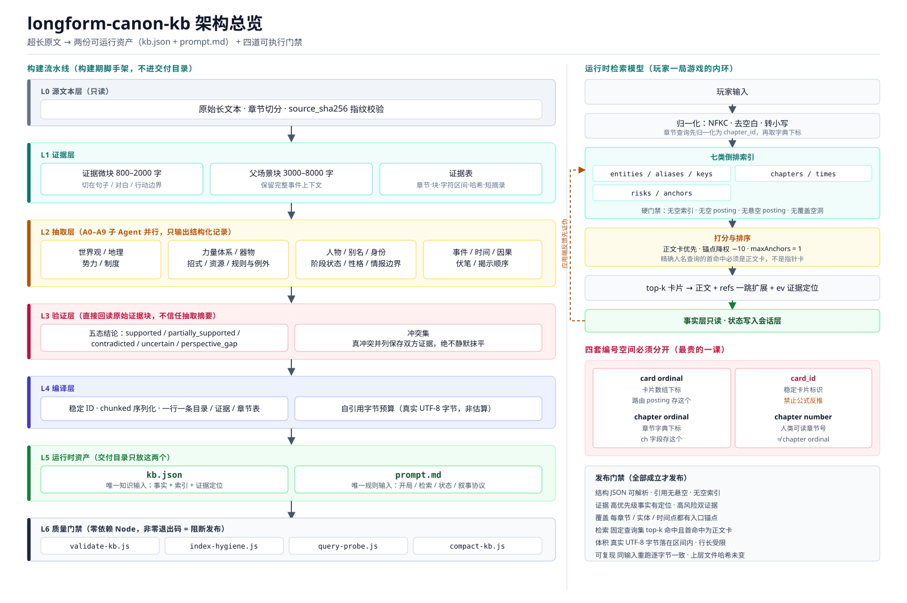

# longform-canon-kb

把百万字到千万字级的长篇叙事文本，做成**两份文件就能开局的 LLM 剧情游戏运行包**，并让检索做到"一次命中"而不是"试错命中"。

```text
原始长文本
  → 证据分层的原子记录（构建期中间产物，可审计、可重跑）
  → kb.json     唯一知识输入
  → prompt.md   唯一规则输入
```

附带一套**零依赖 Node 门禁脚本**，把"能不能发布"从主观判断变成可执行检查。

## 为什么需要它

用长篇小说做 AI 剧情游戏，难点从来不是"写个 prompt"，而是三件事同时成立：

1. **事实不能编。** 每条面向游戏的事实都要能定位回原文的章节、块、字符区间与短摘录；查不到就写 `UNKNOWN`，不要用模型记忆补。
2. **检索要一次命中。** 卡片 ID 是稳定标识，不是可反推的编号；章节字典下标不等于章节号；锚点不该挤占人名查询的 top-k。这些坑一旦踩了，游戏会在第 20 轮开始自相矛盾。
3. **体积有限但事实不能丢。** 手机上跑要压到十几 MB，但高优先级事实、校准层和覆盖锚点一个都不能少。

这个仓库把上述经验固化成可复用的流程、契约与脚本。它不是某部具体小说的知识库，而是一套**构建与验证方法论**。

## 架构



（矢量图 ssets/architecture.svg，位图 ssets/architecture.png）

分层、数据流、运行时检索模型与扩展点的完整说明见 [docs/ARCHITECTURE.md](docs/ARCHITECTURE.md)。

## 快速开始

### 1. 作为 Codex / Claude Skill 使用

把整个仓库放进 skill 目录即可：

```bash
git clone https://github.com/<你>/longform-canon-kb ~/.agents/skills/longform-canon-kb
```

之后当你提到"用长篇小说做 AI 剧情游戏""知识库检索不准""把 KB 压到 15MB"这类需求时，主控 Agent 会加载 `SKILL.md` 并按七阶段流程执行。

### 2. 只用门禁脚本

九个脚本零依赖，Node 18+ 即可运行：

```bash
# 结构与引用门禁（自动识别桌面版 / 卡片路由版）
node scripts/validate-kb.js kb.json --out report.json

# 索引卫生：噪音键、重复 posting、覆盖空洞
node scripts/index-hygiene.js kb.json

# 固定查询回归：空结果与锚点挤占检测
node scripts/query-probe.js kb.json --expect query-set.json --top-k 5

# Chatbox 运行时门禁：哪些卡片 / 字节在 Chatbox 里根本读不到
node scripts/validate-chatbox.js kb.json --out chatbox-report.json

# 字节预算压缩；--dry-run 只测量不写文件
node scripts/compact-kb.js kb.json --out compacted.json --target-max 19398656

# 已有包的迁移：section 内按章节排序（重排序号空间）+ 从时间锚点回填 story_time
node scripts/migrate-kb.js kb.json --out migrated.json --sort-sections --backfill-story-time

# 原文补全：先导工作清单，再把抽取结果合并回库（合并只走脚本）
node scripts/export-worklist.js kb.json --out-dir worklist/
node scripts/apply-patch.js kb.json --ch ch.jsonl --quotes quotes.jsonl --out out.json

# 性能基准：导入耗时 / 体积 / 检索延迟与召回，可与基线比对（Node >= 22.5）
node scripts/bench-kb.js kb.json --out bench.json
node scripts/bench-kb.js kb.json --baseline evals/bench/baseline-gur-final.json
```

脚本接受 `<kb.json>` 作为第一个位置参数（flag 可以写在路径前面），输出 JSON 到 stdout，**非零退出码表示门禁失败**，可直接接进 CI。

### 3. 自检脚本本身

仓库自带一份**故意有缺陷**的夹具，用来确认脚本会真的报错；另有一份最小合规夹具，用来确认脚本不会恒返回失败：

```bash
node scripts/validate-kb.js     evals/fixtures/broken-kb.json   # → ok:false, 悬空引用
node scripts/index-hygiene.js   evals/fixtures/broken-kb.json   # → ok:false, 噪音键 + 重复 posting
node scripts/query-probe.js     evals/fixtures/broken-kb.json --query 主角  # → 锚点超出上限
node scripts/validate-chatbox.js evals/fixtures/mini-valid-kb.json          # → ok:true
```

缺陷夹具里刻意埋了：悬空卡片引用、悬空 posting、重复实体锚点、重复名字 posting、结构词 / 占位名 / `[object Object]` 噪音键，以及章节字典下标的编号空间陷阱。

## 交付物契约

### kb.json

单文件 JSON。根结构、四层命名空间、卡片字段与索引契约见 [references/kb-contract.md](references/kb-contract.md)。

### prompt.md

运行时主控 Prompt，负责开局、检索协议、状态推进与叙事规则。构建期的一切都不写进去。

## 放进 Chatbox 之前

Chatbox 不读 `mobile_router`，而是按固定白名单遍历 14 个 section 自己重建索引。因此
"通过全部结构门禁"和"在 Chatbox 里能检索到"是两件事：

- `anchors` 不作为卡片索引，只用于兜底章节号；`calibrated_supplements` 整段不可见。
- 证据行的引文必须落在 index 2（`[chapter_id, type_code, quote, micro_ref, extra_ref]`）。
- 章节号必须 ≤ 2500，否则带剧透上限的查询会把那些卡整体过滤掉。
- 移动/Web 端的解析上限是 64 MiB，桌面端是 6 MiB 且不适用 story KB 特例。

细节与逐条源码依据见 [references/chatbox-runtime.md](references/chatbox-runtime.md)，
自动检查用 `node scripts/validate-chatbox.js kb.json`。

## 七阶段流程

| 阶段 | 做什么 | 产出 |
| --- | --- | --- |
| 1 摄取分块 | 双层分块（微块 800–2000 字 / 场景块 3000–8000 字），记录字符区间与哈希 | 证据块 + 覆盖率报告 |
| 2 分领域抽取 | A0–A9 子 Agent 并行抽取，只输出结构化记录 | 原子记录 |
| 3 独立验证消歧 | 回读原始证据块，不信任抽取摘要；真冲突并列保存 | 验证结论 + 冲突集 |
| 4 编译单文件 KB | 稳定 ID、chunked 序列化、自引用字节预算 | kb.json |
| 5 检索优化 | 先审计再改，每次只改一类，改完跑回归 | 索引修复 |
| 6 受限平台压缩 | 按预算阶梯降级，弱卡降权而非删除 | 移动版 kb.json |
| 7 门禁发布 | 结构 / 证据 / 覆盖 / 检索 / 行长 / 体积 / 边界 / 保护 / 可复现 | 发布目录（仅两份资产） |

各阶段的子 Agent 定义、system prompt 模板与输出 schema 见 [references/extraction-agents.md](references/extraction-agents.md)。

## 七条铁律

1. 事实必须能回指证据；没有证据写 `UNKNOWN`。
2. 原文只读，游戏层状态永不回写事实层。
3. 不长段复制原文；证据只留定位与短摘录（≤120 字）。
4. 不删唯一的高优先级事实；宁可文件大一点。
5. 体积不是目标；目标是覆盖 + 精度 + 一次命中率。
6. 反馈要验伪；"结构坏了"的报告常常是读取方式不对。
7. 改了必须有回归；没有回归的优化不算优化。

## 参考文档

- [references/extraction-agents.md](references/extraction-agents.md) — A0–A9 抽取子 Agent 的职责、输入契约与输出 schema
- [references/kb-contract.md](references/kb-contract.md) — 单文件 KB 根结构、卡片字段、命名空间与优先级语义
- [references/retrieval-optimization.md](references/retrieval-optimization.md) — 检索失败分类表、修复决策表、回归方法
- [references/mobile-compaction.md](references/mobile-compaction.md) — 平台限制、体积阶梯、行策略、弱卡标记
- [docs/ARCHITECTURE.md](docs/ARCHITECTURE.md) — 分层架构、数据流、检索模型、扩展点

## 关于版权

**本仓库不包含任何具体小说的原文或派生知识库。** 自带的 `evals/fixtures/broken-kb.json` 是人工构造的最小测试夹具，用于验证脚本正确报错。

用本流程处理受版权保护的文本时，请确保你拥有相应授权。流程本身强制"短摘录 + 定位"的证据策略，成品库不应包含可拼接还原原著的长连续文本。

## 许可

MIT，见 [LICENSE](LICENSE)。