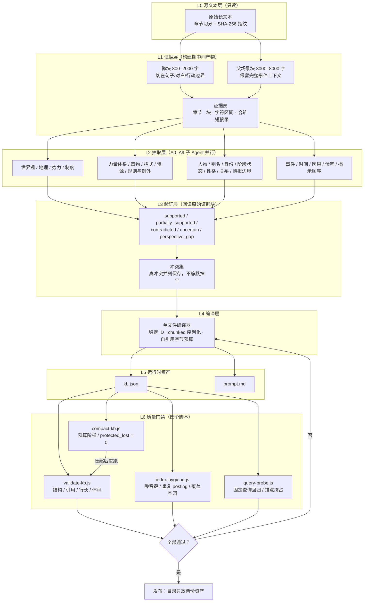
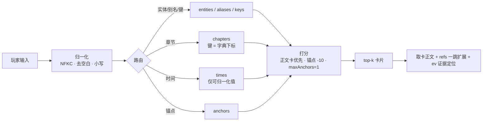

# 架构设计

## 1. 目标与约束

**输入**：一部超长源文本（百万字到千万字量级，数千章）。
**输出**：两份资产，附加给 LLM 即可开局。

```text
kb.json      唯一知识输入（事实 + 索引 + 证据定位）
prompt.md    唯一规则输入（开局 / 检索 / 状态 / 叙事协议）
```

一切中间产物都是构建期脚手架，不进交付目录。

三条不可让步的约束：

1. **可回指**：每条面向游戏的事实都能定位回源文本的章节、块、字符区间与短摘录。
2. **不可污染源**：玩家选择、角色存亡、境界变化、原创设定只写会话层，永不回写事实层。
3. **版权边界**：成品库只留短摘录（默认 ≤120 字），不得出现可拼接还原原著的长连续文本。

## 2. 分层架构



## 3. 数据流

```text
源文本 ──分块──▶ 证据块 ──抽取──▶ 原子记录 ─验证──▶ 通过门禁的记录
                                                          │
                                                          ▼
                                            编译 ──▶ 单文件 KB ──▶ 门禁四件套 ──▶ 发布
                                                          │
                                            体积超限 ──▶ 压缩阶梯 ──▶ 重跑门禁 ─▶ 发布
```

压缩是**派生过程**，完整版始终是唯一事实来源。受限版本（手机 / 聊天应用）从完整版派生，不反向回写。

## 4. 运行时检索模型

LLM 游玩时不是"全库搜索"，而是"先路由、再取卡"：



**四套编号空间必须分开**，这是实际项目里最贵的一课：

| 编号 | 含义 | 取用方式 |
| --- | --- | --- |
| card ordinal | 卡片数组下标 | 路由 posting 存这个 |
| card_id | 稳定卡片 ID | 只能从 `mobile_card_catalog[ordinal][1]` 取，禁止公式反推 |
| chapter ordinal | 章节字典下标 | `ch` 字段存这个 |
| chapter number | 人类可读章节号 | `chapter_catalog[ordinal][2]` |

## 5. 索引契约

七类倒排索引，键与 posting 的语义固定：

```text
entities    实体名 → [ordinal]        （只收 CJK，过滤结构词/占位名）
aliases     别名   → [ordinal]
keys        关键词 → [ordinal]        （与 entities 完全重复的项要删）
chapters    章节字典下标 → [ordinal]
times       可归一化时间点 → [ordinal]（unknown 不入索引）
risks       风险类别 → [ordinal]
anchors     锚点类型 → [ordinal]
```

硬门禁：无空索引、无空 posting、无悬空 posting、无覆盖空洞。

## 6. 门禁与失败模式

| 症状 | 真实根因 | 修复 |
| --- | --- | --- |
| 引用"全部悬空" | 读取方把 `ch` 当章节号，或把锚点序号当卡片序号 | 走 catalog 取真实语义 |
| ID 全对不上 | 用编号公式反推 card_id | 禁止公式，只从 catalog 取 |
| 章节号查不到 | 章节字典下标 ≠ 章节序号 | 先归一化 `chNNNN` 再取 ordinal |
| 人物名前几条是空壳卡 | 锚点与正文卡同分 | 锚点 -10 分，`maxAnchors=1` |
| 命中一堆 `record_type` | 结构词进了名字索引 | 名字索引只收 CJK |
| 命中"未命名""unknown" | 占位名未清洗 | 空串/占位/`[object Object]` 不索引 |
| 体积估算与磁盘不符 | 用字符数估算 | `Buffer.byteLength(serialized, 'utf8')` 实测 |

## 7. 扩展点

- **新增抽取领域**：在 `references/extraction-agents.md` 追加 A 编号子 Agent，定义输入契约与输出 schema。
- **新增门禁**：脚本都是零依赖 Node，接受 `<kb.json>` 为第一个位置参数，输出 JSON 到 stdout，非零退出码接 CI。
- **新增平台**：在 `manifest.size_budget` 写目标区间与硬上限，压缩阶梯复用，门禁自动生效。